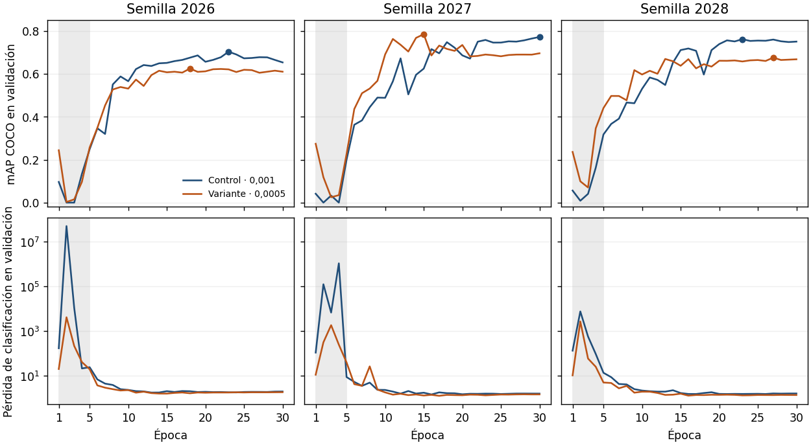

# EXP-001 · Hallazgos en validación

## Rendimiento global

Se recalcularon las seis evaluaciones con COCOeval 2.0.8 a partir de las predicciones y las 98 anotaciones de las 90 imágenes de `valid`. El COCO preparado se reconstruyó desde el original local y su SHA-256 coincide con el de las seis evaluaciones (`8da7dc75022c67fe9e4d806559e8110f89a2cbb8850948f1d89ce5208cdead7c`). Coinciden también las métricas, el AP por clase y los valores de las curvas PR exportadas. Cada evaluación corresponde al brazo, semilla y checkpoint `best` indicados por los metadatos. [Inventario y verificaciones](results/README.md)

Las columnas pareadas muestran control → variante. Δ es variante menos control y DE es la desviación estándar muestral entre semillas. El AP está en escala 0–1.

| Métrica | 2026 (Δ) | 2027 (Δ) | 2028 (Δ) | Control, media ± DE | Variante, media ± DE | Δ, media ± DE |
| --- | --- | --- | --- | ---: | ---: | ---: |
| **mAP COCO, 8 clases** | 0,7021 → 0,6251 (−0,0770) | 0,7716 → 0,7843 (+0,0127) | 0,7613 → 0,6749 (−0,0864) | 0,7450 ± 0,0375 | 0,6947 ± 0,0815 | **−0,0503 ± 0,0547** |
| AP50 | 0,8332 → 0,7431 (−0,0901) | 0,8569 → 0,9037 (+0,0468) | 0,8801 → 0,7600 (−0,1201) | 0,8567 ± 0,0234 | 0,8023 ± 0,0882 | −0,0545 ± 0,0890 |
| AP75 | 0,8261 → 0,7034 (−0,1226) | 0,8569 → 0,8999 (+0,0430) | 0,8500 → 0,7537 (−0,0963) | 0,8443 ± 0,0162 | 0,7857 ± 0,1020 | −0,0587 ± 0,0890 |
| Latencia media (ms) | 10,714 → 10,874 (+0,160) | 10,549 → 11,073 (+0,524) | 10,896 → 10,861 (−0,035) | 10,720 ± 0,173 | 10,936 ± 0,119 | +0,216 ± 0,284 |
| Mediana (ms) | 10,712 → 10,876 (+0,164) | 10,549 → 11,069 (+0,521) | 10,895 → 10,857 (−0,038) | 10,719 ± 0,173 | 10,934 ± 0,118 | +0,215 ± 0,283 |
| p95 (ms) | 10,750 → 10,912 (+0,162) | 10,578 → 11,119 (+0,541) | 10,930 → 10,896 (−0,034) | 10,753 ± 0,176 | 10,976 ± 0,125 | +0,223 ± 0,292 |

Las latencias se recalcularon con las 100 muestras de cada evaluación. Cada pareja se midió en la misma asignación A100, sobre las mismas 16 imágenes en orden, con el mismo calentamiento. La diferencia de latencia cambia de signo entre semillas. [Muestras, FPS y ajustes del benchmark](results/README.md)

Con score 0,25 e IoU 0,50, el recall micro pasa de 69,4 % a 71,4 %, de 69,4 % a 80,6 % y de 76,5 % a 80,6 %. La precisión pasa de 81,9 % a 76,9 %, de 81,0 % a 87,8 % y de 83,3 % a 84,0 %. Al barrer los scores exportados, el recall máximo con precisión ≥ 82 % pasa de 69,4 % a 63,3 %, de 68,4 % a 83,7 % y de 78,6 % a 82,7 %. Cada máximo usa un umbral obtenido en la misma validación. [Resumen y umbrales](results/analysis/resumen.csv)

### Sensibilidad a la clase con una sola instancia

Al promediar las otras siete clases, el mAP sube en las tres parejas. AP50 y AP75 a siete clases suben también en cada una. Esta comprobación mide cuánto cambia la lectura al retirar del promedio el AP de una sola clase.

| Métrica a siete clases | 2026 (Δ) | 2027 (Δ) | 2028 (Δ) | Control, media ± DE | Variante, media ± DE | Δ, media ± DE |
| --- | --- | --- | --- | ---: | ---: | ---: |
| mAP | 0,6881 → 0,7144 (+0,0263) | 0,7390 → 0,7678 (+0,0288) | 0,7272 → 0,7713 (+0,0441) | 0,7181 ± 0,0266 | 0,7511 ± 0,0319 | +0,0330 ± 0,0096 |
| AP50 | 0,8094 → 0,8493 (+0,0399) | 0,8365 → 0,8899 (+0,0534) | 0,8630 → 0,8685 (+0,0056) | 0,8363 ± 0,0268 | 0,8692 ± 0,0203 | +0,0330 ± 0,0247 |
| AP75 | 0,8012 → 0,8039 (+0,0027) | 0,8365 → 0,8856 (+0,0491) | 0,8286 → 0,8614 (+0,0328) | 0,8221 ± 0,0185 | 0,8503 ± 0,0419 | +0,0282 ± 0,0235 |

Cada clase pesa 1/8 en el mAP oficial. El aporte medio de las siete clases al Δ oficial es **+0,0289** y el de `Ibuphil 600 mg` es **−0,0792**. Para esa clase, una sola caja puede cambiar el mAP oficial hasta 0,125. La excepción de 2027 se explica por el AP de la clase, que baja solo de 1 a 0,9 en esa semilla. [Resumen](results/analysis/resumen.csv)

## AP por clase y tipos de error

| Clase | Instancias en valid | 2026 C → V (Δ) | 2027 C → V (Δ) | 2028 C → V (Δ) | Δ medio ± DE |
| --- | ---: | --- | --- | --- | ---: |
| Cipro 500 | 26 | 0,590 → 0,718 (+0,128) | 0,666 → 0,701 (+0,035) | 0,732 → 0,767 (+0,035) | +0,066 ± 0,054 |
| Ibuphil 600 mg | 1 | 0,800 → 0 (−0,800) | 1 → 0,900 (−0,100) | 1 → 0 (−1,000) | −0,633 ± 0,473 |
| Ibuphil Cold 400-60 | 10 | 0,733 → 0,811 (+0,078) | 0,854 → 0,726 (−0,128) | 0,734 → 0,863 (+0,129) | +0,026 ± 0,136 |
| Xyzall 5mg | 10 | 0,397 → 0,413 (+0,016) | 0,314 → 0,543 (+0,229) | 0,409 → 0,543 (+0,134) | +0,126 ± 0,107 |
| blue | 11 | 0,807 → 0,853 (+0,046) | 0,882 → 0,870 (−0,012) | 0,859 → 0,910 (+0,051) | +0,028 ± 0,035 |
| pink | 15 | 0,933 → 0,762 (−0,171) | 0,924 → 0,890 (−0,035) | 0,935 → 0,925 (−0,010) | −0,072 ± 0,087 |
| red | 15 | 0,618 → 0,685 (+0,067) | 0,719 → 0,794 (+0,075) | 0,656 → 0,759 (+0,103) | +0,082 ± 0,019 |
| white | 10 | 0,739 → 0,759 (+0,020) | 0,814 → 0,852 (+0,038) | 0,766 → 0,632 (−0,134) | −0,025 ± 0,094 |

Para diagnosticar las diferencias, se contaron los TP COCO con todo lo exportado (score ≥ 0,001) y a score ≥ 0,25. Para cada anotación sin TP a 0,25 se registró la clase incorrecta de mayor score con IoU ≥ 0,50, si la había. Este solapamiento es un indicador geométrico de confusión y puede coincidir con otra anotación. [TP, FP, AP50 y AP75 por clase](results/analysis/resumen.csv)

- **Cipro 500.** Las anotaciones sin TP cuya candidata de otra clase es `Xyzall 5mg` bajan de 6 a 4, de 5 a 1 y de 4 a 2. Los TP a score 0,25 suben 14→16, 16→18 y 15→19. Con todo lo exportado pasan 20→25, 21→24 y 23→23 a IoU 0,50 y también a 0,75. En 2028 el alcance a ambos IoU ya era el mismo y AP90 sube de 0,674 a 0,779. La ganancia combina menos errores hacia Xyzall con mejor ordenación por score y, según la semilla, más coincidencias a IoU estricto.
- **Xyzall 5mg.** Los FP a 0,25 caen 7→6, 6→1 y 4→2. Los TP a ese corte son 5→5, 2→6 y 5→6, con 7→8, 8→8 y 8→7 TP si se incluye todo lo exportado. En 2027 y 2028 la variante ordena mejor los aciertos frente a los FP. En 2026 AP50 queda en 0,525 y AP75 cae de 0,525 a 0,441, pero AP95 sube de 0,016 a 0,167. Las confusiones en sentido Xyzall→Cipro aumentan en una anotación por pareja a 0,25.
- **red.** A 0,25 los TP suben 10→12, 8→13 y 12→13. A IoU 0,75 con todo lo exportado hay un TP adicional en cada pareja y AP80 y AP85 suben en las tres. El efecto depende del IoU. En 2026 AP75 baja pese al TP adicional, y los FP a 0,25 suben en 2026 y en 2028. AP95 baja en las tres.
- **pink.** Los TP a 0,25 pasan 15→10, 14→13 y 15→14. Con todo lo exportado y a IoU 0,50, pasan 15→14, 15→15 y 15→15. En 2026 hay una detección que deja de emparejarse incluso al incluir todos los scores y AP90 cae de 1 a 0,484. En 2027 y 2028 se recuperan las 15 anotaciones a IoU 0,50, con AP50 menor por el orden de TP y FP. En 2027 dos anotaciones sin TP a 0,25 tienen una caja `Ibuphil Cold 400-60` como alternativa de mayor score y cae también el AP a IoU 0,90 y 0,95.

Estas diferencias describen qué cambia en las salidas de los checkpoints seleccionados. El efecto puede depender de la trayectoria de optimización completa y de la época seleccionada. Los artefactos carecen de predicciones por clase para cada época y de medidas de gradientes o activaciones que permitan atribuir el patrón a un mecanismo interno específico.

## Ibuphil 600 mg

Se localizaron y abrieron los dos JPEG originales de 640 × 640 y sus anotaciones en `data/pills-sxdht/`. El entrenamiento contiene **1** instancia de `Ibuphil 600 mg` frente a **55** de `Ibuphil Cold 400-60`. Validación contiene **1** frente a **10**. Las dos imágenes de 600 mg muestran una pastilla rosada y alargada sobre fondos distintos. Una de las imágenes Cold revisadas (imagen 13 de `valid`) también muestra una pastilla rosada y alargada. El desequilibrio de ejemplos y el parecido en esas imágenes son hipótesis para la confusión. Los JPEG permiten revisar caja y apariencia, y la identidad farmacológica viene dada por las etiquetas.

| Partición | Imagen / anotación COCO original | JPEG bajo `data/pills-sxdht/` | Caja anotada en píxeles `[x, y, ancho, alto]` |
| --- | --- | --- | --- |
| train | 12 / 13 | `train/20210729_174821_jpg.rf.a829d6760b58680055f614078151a710.jpg` | `[243, 212, 87.5, 186]` |
| valid | 61 / 65 | `valid/20210729_174812_jpg.rf.b4996fe24889087fe3fcf4dbfd18e98c.jpg` | `[285, 351, 91.5, 174.5]` |

Las anotaciones proceden de `train/_annotations.coco.json` y `valid/_annotations.coco.json`. La imagen 61 tiene una única anotación y esta delimita la pastilla visible. El CSV usa IDs de anotación del COCO preparado, donde pasa a ser la 66.

| Semilla / brazo | Caja de clase 600 mg, score / IoU | Cold de mayor score sobre la anotación, score / IoU | AP de 600 mg |
| --- | --- | --- | ---: |
| 2026 control | 0,0149 / 0,8703 | 0,8784 / 0,8703 | 0,80 |
| 2026 variante | Sin caja de la clase | Sin caja Cold | 0 |
| 2027 control | 0,0064 / 0,9580 | 0,7506 / 0,9580 | 1,00 |
| 2027 variante | 0,0092 / 0,9326 | 0,8911 / 0,9326 | 0,90 |
| 2028 control | 0,0086 / 0,9684 | 0,7233 / 0,8738 | 1,00 |
| 2028 variante | Sin caja de la clase | 0,5422 / 0,9069 | 0 |

- **2026.** Control exporta exactamente la misma caja `[286.85, 351.86, 85.15, 163.19]` como 600 mg y Cold. La variante exporta dos cajas en la imagen 61 (`white` y `Cipro 500`), ambas con IoU 0 frente a la anotación. El fallo observable es la falta de una caja sobre la pastilla al corte de exportación. Con estas predicciones se desconoce qué puntuó el modelo por debajo del corte.
- **2027.** Ambos brazos exportan la misma geometría con las etiquetas 600 mg y Cold dentro de cada brazo. El score correcto sube de 0,0064 a 0,0092 y la IoU pasa de 0,958 a 0,933. La caja queda por debajo de IoU 0,95, de modo que el AP pasa de 10/10 a 9/10 umbrales. Aquí la caída de AP se explica por localización fina y la confusión Cold persiste en el punto operativo.
- **2028.** La variante localiza la pastilla, incluso con una segunda caja Cold `[285.46, 350.77, 87.16, 174.92]` de IoU 0,9503 y score 0,4617. El error es de clase en lo exportado. El control conserva una caja de clase correcta con IoU 0,9684 y score 0,0086.
- **Ordenación y confusión inversa.** Cuando hay una caja correcta, es la primera del ranking de 600 mg en toda la validación, lo que permite un AP alto con una confianza inferior a 0,015. A score 0,25, **los seis brazos fallan** y cinco ofrecen Cold como candidata por encima del umbral. En sentido Cold→600 mg, variantes 2026 y 2028 sí exportan falsos positivos de 600 mg sobre anotaciones Cold en las imágenes 11 y 13 (2026) y 11 (2028), con scores de 0,0011 a 0,0046 e IoU de 0,9070 a 0,9468. En la imagen 80 hay además solapamientos altos con dos anotaciones superpuestas, Cold y Cipro, para el control 2026 y la variante 2027. [Cajas, scores e IoU](results/analysis/ibuphil.csv)

## Evolución del entrenamiento

| Semilla | Pico de `val/cls_loss` en épocas 1–5 (época), C → V | Épocas con mAP exactamente cero, C → V | mAP medio épocas 1–5, C → V | Mejor época, C → V | mAP de historial, mejor → época 30 (C / V) |
| --- | --- | --- | --- | --- | --- |
| 2026 | 5,03×10⁷ (2) → 4,21×10³ (2) | 2 → 0 | 0,096 → 0,123 | 23 → 18 | 0,703 → 0,653 / 0,625 → 0,610 |
| 2027 | 1,09×10⁶ (4) → 1,87×10³ (3) | 1 → 0 | 0,055 → 0,136 | 30 → 15 | 0,772 → 0,772 / 0,785 → 0,696 |
| 2028 | 7,66×10³ (2) → 2,73×10³ (2) | 0 → 0 | 0,117 → 0,239 | 23 → 27 | 0,761 → 0,750 / 0,676 → 0,668 |

El LR menor atenúa el pico de pérdida en las tres parejas y mejora el mAP inicial medio en +0,0765 ± 0,0472. Sigue habiendo pérdidas tempranas pronunciadas y caídas puntuales de AP. El caso 2027 baja 0,089 entre la mejor época de la variante y la última. A la época 30 el control va por delante en las tres semillas, con una diferencia pareada media de −0,0673 para la variante. El mejor mAP del historial y el de la reevaluación exportada difieren como máximo en 0,000916. [Evolución por época y brechas](results/analysis/resumen.csv)

## Limitaciones y cierre

Tres semillas sobre la misma partición describen variación entre ejecuciones. La misma pastilla de la imagen 61 participa tanto en la selección del checkpoint como en su reevaluación. Hacen falta más casos independientes y etiquetados de 600 mg para estimar su generalización. Verificar las etiquetas con información del producto permitiría distinguir posibles errores de etiquetado de los del detector. Las detecciones exportadas permiten auditar COCO y las confusiones sobre los JPEG sin volver a ejecutar inferencia. Los binarios de los checkpoints y los registros originales de contabilidad de SLURM quedan fuera de la descarga disponible. [Inventario](results/README.md)

## Decisión y siguientes líneas de investigación

**Decisión.** Se conserva el LR de **0,001** como referencia. La mejora del arranque respalda la primera parte de la hipótesis. La variante ganó una de las tres parejas y redujo el mAP medio de ocho clases, por lo que incumplió el criterio de adopción. Las tres parejas y la auditoría local completan la evaluación prevista y cierran EXP-001.

La estabilidad inicial y el rendimiento final respondieron de forma distinta al cambio de LR. Este resultado motiva probar otra vía de mejora de la generalización, la augmentación fotométrica controlada. [Plan de experimentos](../README.md#próximos-pasos)

**Hipótesis aplazada.** Con LR 0,001, extender `warmup_epochs` de 1 a 5 podría reducir los picos tempranos. Con 40 iteraciones por época, el final del calentamiento pasaría del índice 100 al 200. Se mantendrían el LR inicial de sesgos, el coseno y el presupuesto de 30 épocas. La comparación se reserva para una línea futura.

**Próxima línea experimental (EXP-002): augmentación fotométrica controlada.** Tras comprobar que reducir el learning rate mejora la estabilidad inicial pero no el mAP oficial, se propone investigar una estrategia centrada en la generalización. El dataset presenta una ligera diferencia de luminosidad entre particiones, por lo que se estudiará si introducir variaciones moderadas de brillo y contraste (inicialmente ±10 %, con probabilidad de aplicación de 0,5) durante el entrenamiento mejora el rendimiento en validación. Se evitarán modificaciones de tono y saturación, dado que el color es una característica discriminativa para varias clases. La estrategia se evaluará sobre YOLOv10-S y Cascade R-CNN, conservando sus respectivas configuraciones baseline, el presupuesto de 30 épocas y las particiones originales. Se compararán el mAP COCO, las métricas por clase y los errores de detección para determinar si la augmentación aporta mejoras y si estas dependen de la arquitectura.
