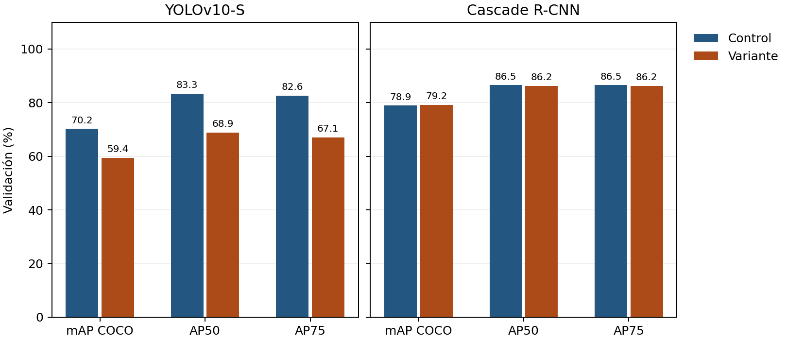
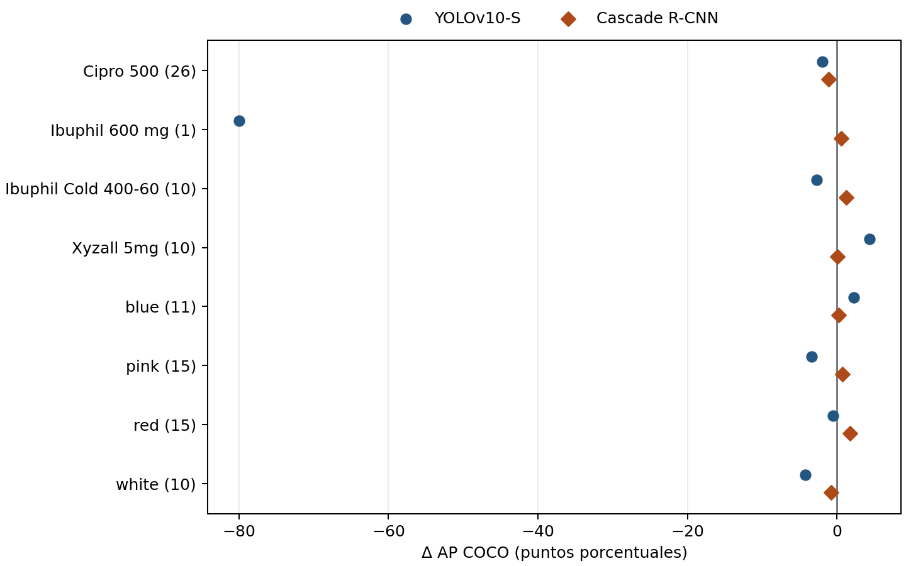
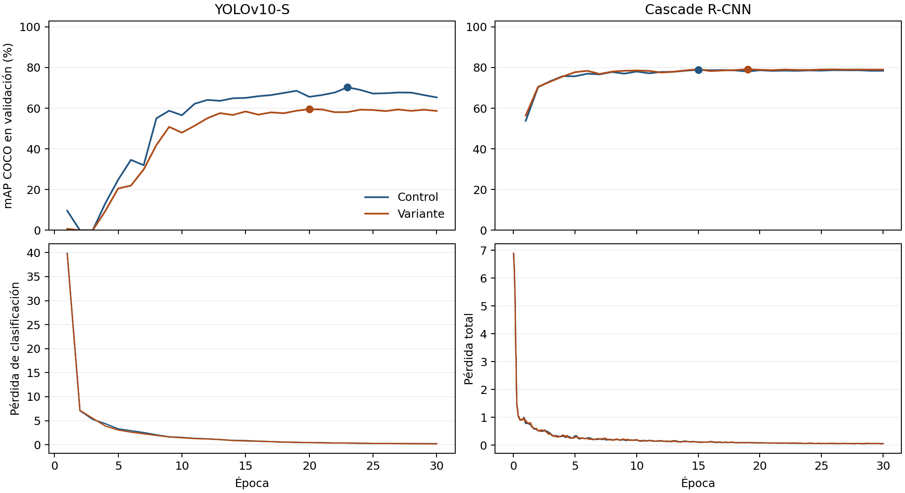

# EXP-002 · Hallazgos

**Cerrado en validación.** YOLOv10-S pierde 10,78 puntos porcentuales de mAP COCO con fotometría. Cascade R-CNN gana 0,34 puntos en la semilla 2026, con AP50 y AP75 ligeramente inferiores y el mismo rendimiento al punto operativo. Se mantienen ambos controles como referencia para la entrega. La variante Cascade queda como candidata si hay tiempo para replicarla.

## Verificación de las ejecuciones

- Se compararon cuatro entrenamientos nuevos de la revisión `66ac347`, con 30 épocas y semilla 2026. Dentro de cada detector coinciden los pesos COCO iniciales, el optimizador, el presupuesto y los parámetros efectivos. La variante aplica ganancias de brillo y contraste independientes en [0,90, 1,10] con probabilidad 0,5 solo en `train`. El preflight satisfactorio registró los tests fotométricos nativos y los sondeos de inicialización. [Protocolo](README.md) · [Inventario de la tanda](results/s2026/provenance/downloaded.tsv)
- El manifiesto faltaba en la descarga. Se regeneró con `scripts.baseline_data` a partir de la copia local y su SHA-256 coincidió exactamente con `inputs.sha256`. El manifiesto coincide con lo registrado por los cuatro entrenamientos y evaluaciones. Contiene 316, 90 y 45 imágenes y 351, 98 y 47 instancias en `train`, `valid` y `test`, respectivamente. Entre particiones no se encontraron nombres de JPEG ni huellas SHA-256 repetidos. Los entrenamientos y la selección de `best` usan `train` y `valid`. `test` se utilizó solo para verificar el manifiesto y la integridad de la partición.
- Se cotejaron los 18 hashes de código y configuración del preflight con el commit local, además de las recetas de cada trabajo, sus versiones registradas (Ultralytics 8.3.161 o Detectron2 0.6), estados `complete`, historiales y rutas de `best`. La tabla enlaza cada entrenamiento con la tanda de evaluación `eval-valid-UgqskU`, trabajo `11987778`. [Auditoría y SHA-256 declarados de los checkpoints](results/analysis/verificacion.json)

| Detector | Trabajo SLURM control | Trabajo SLURM variante | Ruta relativa de `best` en ambos brazos |
| --- | ---: | ---: | --- |
| YOLOv10-S | 11984226 | 11984227 | `weights/best.pt` |
| Cascade R-CNN | 11984228 | 11984229 | `best/model_best.pth` |

Se reconstruyó el COCO de `valid` y se verificó su SHA-256. COCOeval 2.0.8 reprodujo las métricas de cajas y las curvas PR de cada exportación sobre las mismas 90 imágenes y 98 instancias. El mAP oficial promedia las ocho clases y diez umbrales IoU de 0,50 a 0,95, con un máximo COCO de 100 detecciones. El diagnóstico operativo aplica score ≥ 0,25 e IoU ≥ 0,50. [Procedimiento local](results/README.md)

## Rendimiento en validación

### Control frente a variante por arquitectura

Los valores de AP, precisión y recall están en escala 0–1. Δ indica variante menos control en puntos porcentuales (pp). [Resumen reproducible y AP por tamaño](results/analysis/resumen.csv)

| Métrica | YOLO control → variante | Δ YOLO (pp) | Cascade control → variante | Δ Cascade (pp) |
| --- | ---: | ---: | ---: | ---: |
| **mAP COCO, 8 clases** | **0,7021 → 0,5943** | **−10,78** | **0,7887 → 0,7921** | **+0,34** |
| AP50 | 0,8332 → 0,6886 | −14,46 | 0,8653 → 0,8622 | −0,31 |
| AP75 | 0,8261 → 0,6707 | −15,54 | 0,8653 → 0,8622 | −0,31 |
| mAP sin `Ibuphil 600 mg` | 0,6881 → 0,6792 | −0,89 | 0,8914 → 0,8945 | +0,31 |
| AP medio de las cuatro clases de color | 0,7744 → 0,7595 | −1,48 | 0,9089 → 0,9137 | +0,48 |
| Precisión micro (score 0,25, IoU 0,50) | 0,8193 → 0,8611 | +4,18 | 0,9029 → 0,9029 | 0,00 |
| Recall micro (score 0,25, IoU 0,50) | 0,6939 → 0,6327 | −6,12 | 0,9490 → 0,9490 | 0,00 |

YOLO pasa de 68/15/30 a 62/10/36 TP/FP/FN. Al umbral fijado, la variante gana precisión y pierde seis aciertos. Cascade mantiene 93/10/5 TP/FP/FN. Sus FP de `Ibuphil Cold 400-60` bajan de 3 a 1 y los de `blue` y `white` suben uno cada uno. El promedio sobre los diez umbrales IoU favorece ligeramente a Cascade variante, mientras AP50 y AP75 favorecen al control.

### Comparación entre arquitecturas

Cascade supera a YOLO por 8,66 pp de mAP con los controles y por 19,78 pp con las variantes. El cambio de fotometría difiere en 11,12 pp entre detectores en esta pareja por arquitectura.

### Comparabilidad con el baseline histórico de Cascade

El mAP pasa de **0,8021** (entrenamiento `11931348`, época `best` 25) a **0,7887** (control de EXP-002, `11984228`, época `best` 15). Coinciden el COCO de `valid`, el manifiesto, los pesos iniciales, las versiones de las dependencias y la receta declarada de 30 épocas con semilla 2026. Cambian el binario seleccionado, el nodo de entrenamiento y varios hashes de código. La revisión Git exacta del baseline histórico sigue sin confirmar. Ambos informes reproducen las métricas y curvas PR con el evaluador común actual a partir de las predicciones guardadas. [Procedencia histórica](../baseline/results/README.md) · [Auditoría de EXP-002](results/analysis/verificacion.json)

La diferencia se concentra en `Ibuphil 600 mg` (AP 0,1800 → 0,0692), que aporta −1,38 pp al cambio oficial de −1,34 pp. Las otras siete clases aportan +0,04 pp y su mAP pasa de 0,8909 a 0,8914. Cascade permite operaciones CUDA no deterministas, una posible fuente de variación cuya contribución no se puede aislar con estas dos ejecuciones. El contraste de fotometría usa el control contemporáneo de 0,7887 con la misma revisión y nodo de entrenamiento que la variante. [Configuración de Cascade](../baseline/README.md#f-recetas-e-hiperparámetros)

### Benchmark de inferencia

Se recalcularon las latencias a partir de 100 tiempos por checkpoint, tras 20 iteraciones de calentamiento, con 16 imágenes de `valid` en el mismo orden, batch 1, forma nominal 640 × 640 y FP32. Las cuatro mediciones usan la misma NVIDIA A100 PCIe de 40 GB, el mismo host `c210-5` y la asignación `11987778`. Se mide desde el array BGR ya decodificado hasta las detecciones devueltas a CPU, incluido el posprocesado de cada detector. [Protocolo y hardware](results/analysis/verificacion.json) · [Latencias recalculadas](results/analysis/resumen.csv)

| Detector y brazo | Media (ms/imagen) | Mediana (ms) | p95 (ms) | FPS derivados de la media |
| --- | ---: | ---: | ---: | ---: |
| YOLO control | 10,625 | 10,625 | 10,663 | 94,12 |
| YOLO variante | 10,834 | 10,833 | 10,871 | 92,30 |
| Cascade control | 29,503 | 29,516 | 29,786 | 33,90 |
| Cascade variante | 29,439 | 29,441 | 29,751 | 33,97 |

Cascade control tarda 2,78 veces lo que YOLO control por imagen. La latencia media de YOLO sube 0,209 ms con fotometría y la de Cascade baja 0,064 ms. Son diferencias pequeñas medidas una vez por checkpoint, con la misma ruta de inferencia dentro de cada arquitectura.

### AP por clase y sensibilidad a Ibuphil 600 mg

| Clase | Instancias `train` / `valid` | YOLO control → variante | Δ YOLO (pp) | Cascade control → variante | Δ Cascade (pp) |
| --- | ---: | ---: | ---: | ---: | ---: |
| Cipro 500 | 79 / 26 | 0,590 → 0,570 | −1,95 | 0,880 → 0,869 | −1,08 |
| Ibuphil 600 mg | 1 / 1 | 0,800 → 0,000 | −80,00 | 0,069 → 0,075 | +0,58 |
| Ibuphil Cold 400-60 | 55 / 10 | 0,733 → 0,706 | −2,73 | 0,904 → 0,917 | +1,27 |
| Xyzall 5mg | 57 / 10 | 0,397 → 0,440 | +4,38 | 0,821 → 0,821 | +0,05 |
| blue | 42 / 11 | 0,807 → 0,829 | +2,28 | 0,945 → 0,947 | +0,25 |
| pink | 35 / 15 | 0,933 → 0,899 | −3,42 | 0,933 → 0,940 | +0,73 |
| red | 40 / 15 | 0,618 → 0,613 | −0,55 | 0,908 → 0,925 | +1,71 |
| white | 42 / 10 | 0,739 → 0,697 | −4,24 | 0,850 → 0,842 | −0,79 |

El AP de `Ibuphil 600 mg` pesa 1/8 en el promedio oficial. Su caída aporta **−10,00 pp** al delta de YOLO y las otras siete clases aportan **−0,78 pp**. En Cascade, la clase aporta **+0,07 pp** y las otras siete **+0,27 pp**. El promedio de siete clases conserva el signo de ambos resultados. `test` contiene cero instancias anotadas de `Ibuphil 600 mg`, de modo que una evaluación final en esa partición no permitirá estimar el AP de esa clase. [AP, AP50, AP75 y conteos por clase](results/analysis/por_clase.csv)

## Análisis de errores

### Ibuphil 600 mg e Ibuphil Cold 400-60

La única anotación de `Ibuphil 600 mg` en `valid` es la 66 en el COCO preparado, imagen 61. Los cuatro checkpoints localizan la pastilla rosada y alargada con una caja etiquetada como `Ibuphil Cold 400-60`, y los cuatro pierden el TP de 600 mg a score 0,25. La caja Cold de YOLO variante queda justo por debajo de ese corte. [Ejemplo de Cascade control](results/s2026/cascade/control/evaluation/examples/failure-61.jpg) · [Ejemplo de Cascade variante](results/s2026/cascade/variante/evaluation/examples/failure-61.jpg)

| Detector y brazo | Caja de 600 mg, score / IoU | Posición de la caja correcta en el ranking de 600 mg | Candidata Cold, score / IoU |
| --- | ---: | ---: | ---: |
| YOLO control | 0,0149 / 0,870 | 1 de 3 | 0,8784 / 0,870 |
| YOLO variante | Sin caja exportada de 600 mg en la imagen | — | 0,2353 / 0,898 |
| Cascade control | 0,0032 / 0,904 | 13 de 82 | 0,9675 / 0,906 |
| Cascade variante | 0,0022 / 0,905 | 12 de 51 | 0,9722 / 0,906 |

En YOLO control, la caja correcta encabeza el ranking de su clase y acierta ocho de los diez IoU COCO pese a tener score 0,0149. En la variante persiste una caja Cold con buena localización y desaparece la etiqueta correcta de lo exportado para esa imagen. Esto explica la caída de AP de 600 mg sin atribuirla a un fallo geométrico. En Cascade, la caja correcta supera los mismos nueve IoU COCO en ambos brazos y gana una posición pese a bajar de score. La pequeña ganancia de AP de esa clase concuerda con el cambio de ordenación. El desbalance de entrenamiento y la semejanza visual con algunas pastillas Cold son hipótesis para la confusión. [Auditoría de cajas, scores e IoU](results/analysis/ibuphil.csv)

### Cipro 500, Xyzall 5mg y pink

- **Cipro 500 y Xyzall 5mg.** En YOLO, las anotaciones de Cipro sin TP con una caja candidata de Xyzall a score ≥ 0,25 e IoU ≥ 0,50 pasan de 6 a 2. Cipro mantiene 14 TP al corte y su AP baja 1,95 pp. En la imagen 19, una caja Xyzall sobre Cipro pasa de score 0,879 (IoU 0,846) a 0,077 (IoU 0,795), y Cipro sigue sin TP. En la colección completa, los FP de Xyzall pasan de 7 a 2 y los TP de 5 a 4 al corte. Su AP gana 4,38 pp. [Imagen 19, YOLO control](results/s2026/yolo/control/evaluation/examples/failure-19.jpg) · [YOLO variante](results/s2026/yolo/variante/evaluation/examples/failure-19.jpg)
- **Clases de color.** En YOLO, `pink` conserva 15 TP a IoU 0,75 con las predicciones exportadas, suma un FP al punto operativo y pierde 3,42 pp de AP. `red` pierde tres TP al punto operativo y `white` pierde un TP incluso al incluir todos los scores exportados a IoU 0,50. En Cascade, `red` aporta la mayor ganancia de AP (+1,71 pp) y `white` pierde 0,79 pp. [Conteos](results/analysis/por_clase.csv) · [Candidatas a confusión](results/analysis/confusiones.csv) · [Cajas por anotación](results/analysis/errores_instancias.csv)

El análisis de confusiones registra solapamientos de cajas de clase distinta sobre anotaciones sin TP. Una candidata puede corresponder a otro objeto cercano. Los JPEG son ejemplos seleccionados y los conteos proceden de la evaluación completa.

## Evolución del entrenamiento

| Detector y brazo | Mejor época | mAP del historial en `best` | mAP en época 30 | mAP de `best` reevaluado |
| --- | ---: | ---: | ---: | ---: |
| YOLO control | 23 | 0,7030 | 0,6532 | 0,7021 |
| YOLO variante | 20 | 0,5950 | 0,5866 | 0,5943 |
| Cascade control | 15 | 0,7887 | 0,7843 | 0,7887 |
| Cascade variante | 19 | 0,7921 | 0,7898 | 0,7921 |

YOLO variante queda por detrás de su control al seleccionar `best` y al llegar a la época 30. Cascade se estabiliza pronto en ambos brazos, con una diferencia pequeña a favor de la variante al final. Las diferencias entre el historial de `best` y la reevaluación son inferiores a 0,001 en YOLO y nulas en Cascade. Los contrastes principales usan la reevaluación exportada. [Historiales](results/s2026/) · [Resumen](results/analysis/resumen.csv)

## Limitaciones

- Se utilizó una semilla emparejada por arquitectura y una sola partición de validación, que también sirvió para seleccionar los checkpoints. La variabilidad entre semillas y el rendimiento en `test` quedan por medir. La comprobación de integridad entre splits cubre nombres y archivos idénticos. El análisis exploratorio señaló tres pares candidatos a similitud perceptual entre particiones, pendientes de revisión. [Limitaciones del dataset](../baseline/findings.md#limitaciones-del-dataset)
- Los hashes y las rutas enlazan las evaluaciones con los checkpoints registrados. Los binarios entrenados y los pesos iniciales están ausentes, por lo que el recálculo usa predicciones exportadas y la integridad binaria de los pesos queda sin verificación local. El benchmark proviene de CESGA, con una secuencia fija de ejecución y sin repeticiones independientes. [Archivos para repetir la inferencia](results/README.md#comprobación-binaria-opcional)
- El primer preflight falló al serializar el `MagicMock` de `CheckedWeights.transfer`. El segundo omitió ese test concreto y completó las pruebas fotométricas nativas y los sondeos con pesos reales. El test corregido ahora usa un diccionario de transferencia y comprueba su JSON. La suite local pasó 21 pruebas y omitió tres que requieren los entornos de los detectores. [Test corregido](../../tests/test_baseline.py)

## Conclusiones

- **YOLOv10-S.** Descartar la política ensayada. La caída oficial está dominada por una sola clase y se mantiene, con mucha menor magnitud, en las otras siete. También empeoran el AP medio de las clases de color y el recall al punto operativo.
- **Cascade R-CNN.** La variante cumple el criterio exploratorio de mAP oficial y AP medio de clases de color en esta semilla. Se conserva el control para la entrega porque la ganancia es pequeña, AP50 y AP75 bajan y el punto operativo da el mismo total de aciertos y errores. Una repetición emparejada sería necesaria para recomendar la variante con más confianza.
- **Plan original al cierre de EXP-002.** Probar primero una única fusión predefinida de los controles con las predicciones guardadas (EXP-004). A score 0,25 e IoU 0,50, los controles comparten 67 TP, YOLO aporta uno exclusivo (`white`, imagen 51), Cascade aporta 26 y quedan cuatro anotaciones sin TP de ninguno. El margen de cobertura es pequeño en ese punto. La hipótesis a comprobar es si fusionar cajas y scores mejora el mAP de Cascade. Si la prueba breve queda empatada o pierde, priorizar EXP-003 sobre Cascade con una política geométrica conservadora y una pareja comparable, si queda presupuesto. Fijar el checkpoint y el protocolo antes de abrir `test`. [Solapamiento operativo](results/analysis/verificacion.json) · [Plan priorizado](../README.md#próximos-pasos)

Los identificadores de ese plan eran provisionales. La fusión se realizó como [EXP-003](../exp-003-ensemble/findings.md). La geometría se estudió en [EXP-004 para YOLO](../exp-004-yolo-factorial/findings.md) y [EXP-005 para Cascade](../exp-005-cascade-geometric/findings.md).
