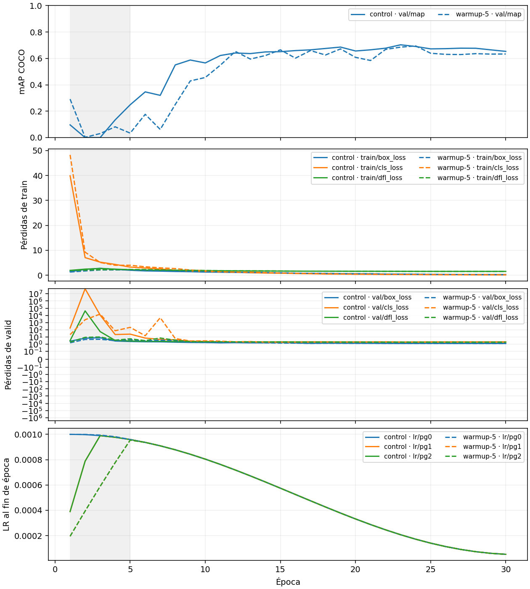

# EXP-006 · Hallazgos en validación

## Verificación y condiciones

Se recalcularon ambas evaluaciones con COCOeval 2.0.8 sobre las predicciones exportadas y las 98 anotaciones de las 90 imágenes de `valid`. Coinciden el mAP, el AP por clase, las curvas PR y el punto operativo. El COCO reconstruido desde las anotaciones originales coincide por SHA-256 con el manifiesto y ambos informes. El [resumen del analizador](results/analysis/summary.json) registra `coco_verified: true`.

La única pareja usó la semilla 2026, los mismos pesos iniciales, 30 épocas y la revisión `7f459491ea21cf61733989c18a6ad362c390c534`. Las configuraciones efectivas solo difieren en `warmup_epochs` y en las rutas de salida. Los trabajos de entrenamiento `11994691` y `11994693` figuran como `COMPLETED|0:0`. La evaluación conjunta `12001925` registró las rutas y huellas de los dos checkpoints `best`, que coinciden con los informes de evaluación. Los binarios permanecen en CESGA. [Procedencia y artefactos](results/README.md)

## Rendimiento global

Δ expresa warm-up 5 menos control. El AP está en escala 0–1.

| Métrica | Control | Warm-up 5 | Δ |
| --- | ---: | ---: | ---: |
| **mAP@0,50:0,95 COCO** | 0,70209365 | 0,69335260 | −0,00874105 |
| AP50 | 0,83319268 | 0,80533068 | −0,02786200 |
| AP75 | 0,82607634 | 0,79760609 | −0,02847025 |
| mAP sin Ibuphil 600 mg | 0,68810703 | 0,67811726 | −0,00998977 |
| Precisión micro | 0,8193 | 0,8000 | −0,0193 |
| Recall micro | 0,6939 | 0,6531 | −0,0408 |
| TP / FP / FN | 68 / 15 / 30 | 64 / 16 / 34 | −4 / +1 / +4 |
| Latencia media (ms) | 10,732 | 10,846 | +0,114 |
| Mediana (ms) | 10,731 | 10,850 | +0,119 |
| p95 (ms) | 10,768 | 10,877 | +0,109 |
| FPS (1 000 / media) | 93,183 | 92,202 | −0,982 |

La precisión y el recall corresponden a score ≥ 0,25 e IoU ≥ 0,50. Se midieron ambos checkpoints en la misma asignación A100 PCIe de 40 GB, con las mismas 16 imágenes en orden, lote 1, 640 × 640, FP32, 20 calentamientos y 100 mediciones por brazo. Los tiempos describen esa asignación y el orden de ejecución registrado. [Métricas de control](results/phase-a/eval-a-s2026/control/metrics.json) · [Métricas de warm-up 5](results/phase-a/eval-a-s2026/warmup-5/metrics.json)

### AP por clase y tamaño

| Clase | Instancias en valid | Control | Warm-up 5 | Δ |
| --- | ---: | ---: | ---: | ---: |
| Cipro 500 | 26 | 0,5897 | 0,6189 | +0,0292 |
| Ibuphil 600 mg | 1 | 0,8000 | 0,8000 | 0,0000 |
| Ibuphil Cold 400-60 | 10 | 0,7330 | 0,6726 | −0,0605 |
| Xyzall 5mg | 10 | 0,3966 | 0,4550 | +0,0584 |
| blue | 11 | 0,8066 | 0,8173 | +0,0106 |
| pink | 15 | 0,9333 | 0,8398 | −0,0935 |
| red | 15 | 0,6184 | 0,6810 | +0,0626 |
| white | 10 | 0,7391 | 0,6623 | −0,0768 |

Las mayores subidas se observan en `red` y `Xyzall 5mg`. Las mayores caídas se observan en `pink`, `white` e `Ibuphil Cold 400-60`. El AP de la única instancia de `Ibuphil 600 mg` permanece en 0,8000 y la caída del promedio persiste al excluir la clase. [Curvas PR de control](results/phase-a/eval-a-s2026/control/pr_curves.png) · [Curvas PR de warm-up 5](results/phase-a/eval-a-s2026/warmup-5/pr_curves.png)

| Rango de tamaño COCO | Instancias | Control | Warm-up 5 | Δ |
| --- | ---: | ---: | ---: | ---: |
| Pequeño | 2 | 0,0000 | 0,0000 | 0,0000 |
| Mediano | 22 | 0,6373 | 0,5674 | −0,0700 |
| Grande | 74 | 0,7067 | 0,7712 | +0,0645 |

El recuento usa las áreas de las anotaciones y los rangos del evaluador COCO. La variante gana AP en objetos grandes y pierde en medianos. El soporte de dos anotaciones limita la lectura del AP de objetos pequeños.

## Evolución del entrenamiento

| Métrica del historial | Control | Warm-up 5 |
| --- | ---: | ---: |
| Pico de `val/cls_loss` en 1–5 (época) | 50 317 300 (2) | 15 135,7 (3) |
| Épocas con mAP exactamente cero en 1–5 | 2 | 0 |
| Épocas con mAP exactamente cero en 1–30 | 2 | 0 |
| mAP medio en 1–5 | 0,09576098 | 0,087875858 |
| Mejor época | 23 | 24 |
| mAP de la mejor época | 0,703009 | 0,694520 |
| mAP de la época 30 | 0,653203 | 0,633456 |
| Brecha entre el máximo y la época 30 | 0,049806 | 0,061064 |

El warm-up extendido redujo el pico inicial de clasificación en validación y evitó los ceros exactos. En la segunda época el mAP de la variante aún era 0,00204039. La pérdida de clasificación de validación volvió a subir en la séptima época, hasta 4 686,97. Las pérdidas de entrenamiento disminuyeron en ambos brazos y la variante acabó con `train/cls_loss` de 0,182 frente a 0,198 del control. La variante terminó con mAP inferior y una brecha mayor respecto a su máximo. La tabla usa el historial por época. El rendimiento principal procede del recálculo del checkpoint `best`.

El cargador registró 40 minibatches por época. La interpolación llegó a los índices inclusivos 100 y 200. Al final de la primera época, el LR registrado en los grupos de pesos `pg1` y `pg2` fue 0,000390 en el control y 0,000195 en la variante. El grupo de sesgos `pg0` registró 0,001 en ambos. Al final de la quinta época, los pesos usaban 0,000958934 y 0,000954139, respectivamente. Desde la sexta, los tres grupos registraron la misma secuencia en ambos brazos, de 0,000936362 hasta 0,0000526021. Estos puntos son lecturas al final de cada época. [Historial de control](results/phase-a/s2026/control/train/history.csv) · [Historial de warm-up 5](results/phase-a/s2026/warmup-5/train/history.csv)

## Ejemplos emparejados

- **Imagen 57.** Ambos marcan el `Cipro 500` anotado como `Xyzall 5mg` por encima del corte operativo. El score de la predicción cambia de 0,2962 a 0,4868. [Control](results/phase-a/eval-a-s2026/control/examples/image-57.jpg) · [Warm-up 5](results/phase-a/eval-a-s2026/warmup-5/examples/image-57.jpg)
- **Imagen 61.** Ambos predicen `Ibuphil Cold 400-60` al corte operativo y omiten `Ibuphil 600 mg`. La etiqueta correcta sí figura entre las predicciones exportadas con scores de 0,0149 y 0,0121, por debajo de 0,25. [Control](results/phase-a/eval-a-s2026/control/examples/image-61.jpg) · [Warm-up 5](results/phase-a/eval-a-s2026/warmup-5/examples/image-61.jpg)
- **Imagen 80.** Ambos aciertan un `Cipro 500` y un `Ibuphil Cold 400-60` y omiten otros dos `Cipro 500`. El control también acierta `Xyzall 5mg`. En warm-up 5, el mayor score de esa clase en la imagen es 0,0863 y queda por debajo del corte. [Control](results/phase-a/eval-a-s2026/control/examples/image-80.jpg) · [Warm-up 5](results/phase-a/eval-a-s2026/warmup-5/examples/image-80.jpg)

## Decisión y alcance

**EXP-006 se cierra en la fase A y se mantiene el warm-up de la baseline.** La caída absoluta de 0,00874105 en el mAP oficial está dentro del margen exploratorio de 0,01. Sin embargo, la vía de continuación por estabilidad también exigía conservar el mAP medio de las primeras cinco épocas y este cayó en 0,007885122. Tampoco hubo mejora del mAP oficial que habilitara la otra vía. Las fases B y C quedaron sin ejecutar. [Criterio preestablecido](README.md#fases-y-decisión)

La evidencia se limita a una pareja con semilla 2026 en `valid`. La desviación estándar entre semillas queda indefinida. Los resultados separan una reducción de los picos y los ceros de una mejora predictiva, y dejan sin medir la respuesta con otras semillas o duraciones de warm-up. La partición `test` queda reservada para la evaluación final del proyecto.
